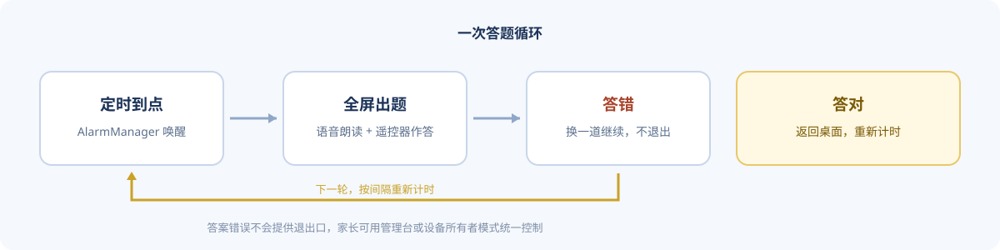
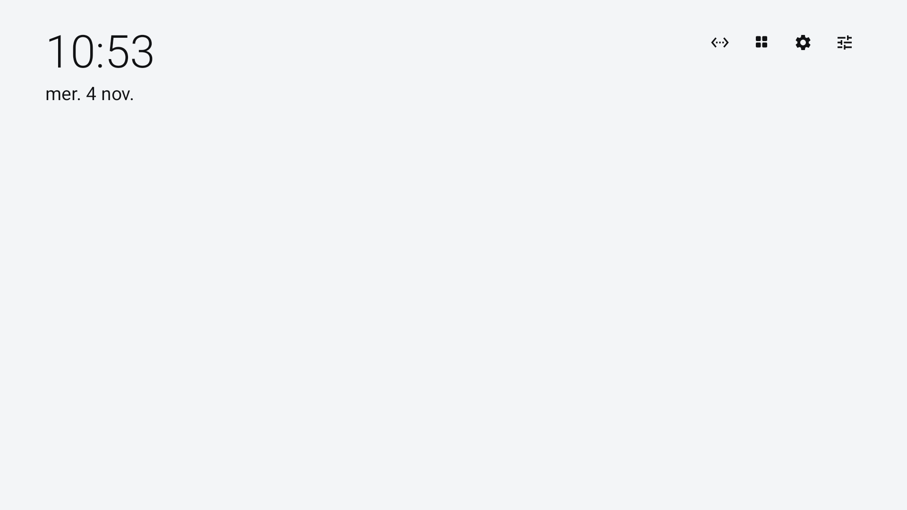
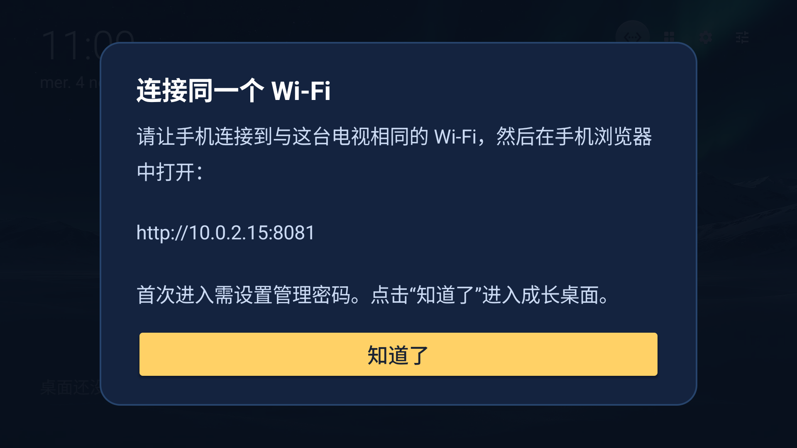

<p align="center">
  
</p>

<p align="center">
  <a href="LICENSE"></a>
  
  
  
  
</p>

<h1 align="center">宝贝成长桌面 · GrowQuiz Launcher</h1>

<p align="center"><em>一台会提问的电视桌面：到点自动出题，答对才回到动画片。</em></p>

---

## 这是什么

孩子看完一集还想再看一集，家长不可能每次都守在旁边。

**宝贝成长桌面**把 Android TV 的桌面换成一个小而快的启动器，并按你设定的间隔把全屏答题弹到最前面：题答错了就换一道继续，答对了才回到桌面。题目全部离线内置，音量键、返回键都进不去动画片——想继续看，先答对一题。

它基于开源桌面 [Plume Launcher](https://github.com/aradhyas8/Plume_Launcher)（无广告、无账号、无统计的极简 TV 桌面，APK 约 0.4 MB），在保留原桌面全部功能的前提下加入儿童问答模块；宝贝成长桌面自身安装包约 0.65 MB。

## 核心功能

| | 功能 | 说明 |
|---|---|---|
| ⏱ | **定时全屏问答** | 到达设定间隔（1 分钟 – 24 小时）自动弹出问答，抢占前台并全屏显示 |
| 🔁 | **答错换题，答对返回** | 答案错误只换一道题，不提供"退出"；答对后自动返回桌面并重新计时 |
| 🧠 | **8000 道离线题库** | 5–14 岁十个年龄段，每段 800 题，无需联网、无需登录 |
| 🔊 | **语音朗读题目** | 调用系统 TTS 朗读题干，识字不多的孩子也能独立完成 |
| 🔒 | **设备所有者锁定** | 配置 Device Owner 后启用 Lock Task，答题期间无法用遥控器切走 |
| 📱 | **手机当管理台** | 电视内置一个局域网网页控制台（默认 `:8081`），手机浏览器即可改年龄、间隔、立即出题 |
| ♻️ | **开机自动恢复** | 重启电视后自动重新排定下一次问答，不必手动打开应用 |
| 🖥 | **完整桌面功能** | 应用行、继续观看、HDMI 信号源、壁纸/屏保、遥控器按键自定义等上游能力全部保留 |
| 🚫 | **不联网更新** | 已关闭上游的自动更新检查，不会被上游包覆盖 |

## 一次答题循环

<p align="center">
  
</p>

## 界面

<p align="center">
  
  
</p>

左：默认启动后的极简桌面（可自由添加应用）。右：启动时提示家长在手机浏览器打开局域网管理台，首次进入需设置管理密码。

## 快速开始

### 1. 构建 APK

```sh
git clone https://github.com/1zzzzzlll/GrowQuizLauncher.git
cd GrowQuizLauncher
./gradlew assembleRelease
# 产物：app/build/outputs/apk/release/app-release.apk
```

需要 JDK 17+ 与 Android SDK（`compileSdk 36`）。未提供 `keystore.properties` 时，release 包使用本机 debug 签名，自用安装没有问题。

### 2. 安装到电视

```sh
# 电视开启开发者选项与网络调试后
adb connect 192.168.1.20:5555
adb install -r app-release.apk
```

也可以用 U 盘 + 文件管理器、或电视上的 Downloader 类应用侧载安装。

### 3. 设为默认桌面

打开 **设置 → 应用 → 默认应用 → 主屏幕**，选择「宝贝成长桌面」。安装脚本 `tools/growquiz-install.sh` 也封装了安装与切换步骤：

```sh
sh tools/growquiz-install.sh app/build/outputs/apk/release/app-release.apk 192.168.1.20:5555
```

脚本只切换默认桌面，不会禁用原桌面，出问题随时切回去。

### 4. 父母设置

- **电视端**：桌面 → 设置 → 「儿童定时问答」，选择孩子年龄、答题间隔、开关，可立即测试。
- **手机端**：电视屏幕会显示形如 `http://10.0.2.15:8081` 的地址。让手机连同一个 Wi-Fi，在浏览器打开即可设置年龄、间隔、立即出题（首次进入需设置至少 6 位管理密码）。

> 管理台只在局域网内可达，随桌面进程运行，不上传任何数据。

### 5.（可选）开启强锁定

普通默认桌面模式下，孩子仍可能通过系统设置或语音搜索切走应用。需要更强的约束时，配置 Device Owner：

```sh
adb shell dpm set-device-owner dev.plume.growquiz/dev.plume.quiz.QuizDeviceAdminReceiver
```

配置后答题期间启用 Lock Task，返回/主页键无法脱离。**注意**：Device Owner 不是 root，也不等于刷机；部分电视要求设备未登录账号、且没有其他设备所有者。移除方式取决于厂商系统，必要时需通过系统管理入口或恢复出厂设置处理，**请先备份数据并在可折腾的设备上试**。

## 工作原理

| 模块 | 位置 | 职责 |
|---|---|---|
| 定时调度 | `quiz/QuizScheduler.kt` | 用 `AlarmManager.setAlarmClock()` 排定下一次触发；Android 12+ 无精确闹钟权限时降级为 `set()` |
| 开机恢复 | `quiz/BootReceiver.kt` | 监听开机广播，读取上次排定时间并重新调度 |
| 答题界面 | `quiz/QuizActivity.kt` | 全屏、遥控器优先；错误答案换题，正确答案 1.3 秒后返回；有 Device Owner 时 `startLockTask()` |
| 答题规则 | `quiz/QuizRules.kt` | 纯 Kotlin 逻辑，脱离 Android 框架，便于单元测试 |
| 题库 | `app/src/main/assets/questions.json` | 8000 题，含年龄段、分类、选项、答案下标与解析 |
| 题目生成 | `tools/generate_questions.py` | 确定性生成 + 校验题库（数值干扰项自动去重、答案唯一） |
| 局域网管理台 | `web/WebAdminServer.kt` | 纯 JDK `ServerSocket` 单页服务，SHA-256 加盐口令、24 小时会话 Cookie，无第三方依赖 |
| 语音 | `quiz/TtsProbe.kt` + `QuizActivity` | 系统 TTS 朗读题干，检测引擎可用性 |
| 桌面本体 | `dev.plume.*` | 上游 Plume 的桌面、壁纸、屏保、按键重映射等 |

## 题库

| 年龄段 | 题量 | 分类分布（全库） |
|---|---|---|
| 5 – 14 岁，每岁一段 | 800 × 10 = **8000** | 数学 3515 · 语文 1386 · 应用 731 · 英语 614 · 图形 492 · 科学 376 · 逻辑 262 · 安全 226 · 生活 200 · 历史 100 · 地理 98 |

每岁构成：数学/逻辑/图形/应用 500 题（程序化生成）+ 语文与英语 200 题 + 科学/安全/生活/历史/地理 100 题。语文、英语、历史、地理等文科内容按 5-6、7-8、9-10、11-12、13-14 五个年龄段分层，对齐部编版语文、PEP 英语与中小学常识范围。

重新生成或扩充题库：

```sh
python3 tools/generate_questions.py
```

脚本会重写 `app/src/main/assets/questions.json` 并做一致性校验。想换成自己出的题，按同样的 JSON 结构替换即可（`age`、`category`、`question`、`options`、`answerIndex`、`explanation`）。

## 项目结构

```
app/src/main/java/dev/plume/
├── quiz/            # 问答模块：调度、答题、题库读取、设备所有者、TTS
├── web/             # 局域网管理台（内置 HTTP 服务）
├── MainActivity.kt  # 桌面主界面
├── Remap.kt         # 遥控器按键重映射
└── ...              # 上游桌面、壁纸、屏保等
app/src/main/assets/questions.json   # 离线题库
docs/                                # 文档、截图、站点页
tools/                               # 安装脚本、题库生成、上游设备探针
```

## 已知限制

- **强锁定依赖 Device Owner**：不配置时只是"默认桌面"，无法阻止通过系统设置切走。
- **精确闹钟**：Android 12+ 若未授予「闹钟和提醒」权限，触发时间可能被系统推迟数分钟。
- **TTS**：电视没有可用语音引擎时题目不会朗读，其余功能正常。
- **Fire TV**：Fire OS 不把 Home 键交给第三方应用，首个桌面会先闪现约 5 秒；细节见[上游文档](docs/UPSTREAM-PLUME.md#fire-tv)。
- **不做家长端远程监督**：管理台只在同一局域网内可用，且仅在桌面进程存活时开启。

## 隐私

没有账号、没有广告、没有统计上报。应用只在以下情况使用网络：加载继续观看的海报、你主动选择的在线壁纸/屏保/天气。管理台只在局域网监听，密码与设置存在电视本地。

## 参与贡献

欢迎提 Issue 与 PR。改动前建议先说明使用场景（电视型号 / Android 版本 / 是否 Device Owner），涉及答题行为的改动请补充 `app/src/test` 下的单元测试，跑通：

```sh
./gradlew test
```

## 许可证与致谢

- 本项目基于 [Plume Launcher](https://github.com/aradhyas8/Plume_Launcher)（作者 aradhyas8）二次开发，上游评估提交 `e7e663ba85a5028e29206ad9a67ad248c500042d`，遵循 **GPL-3.0** 发布，完整许可见 [LICENSE](LICENSE)。任何分发版本（含修改版）都必须同样以 GPL-3.0 开源并提供完整源码。
- 上游的完整功能说明、安装细节与隐私条目已归档在 [docs/UPSTREAM-PLUME.md](docs/UPSTREAM-PLUME.md)。
- 屏保油画（公有领域）、壁纸包、Aerial 场景与图标来源见上游文档的 Credits 一节。
